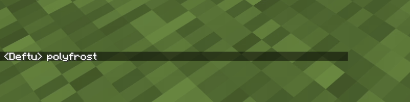
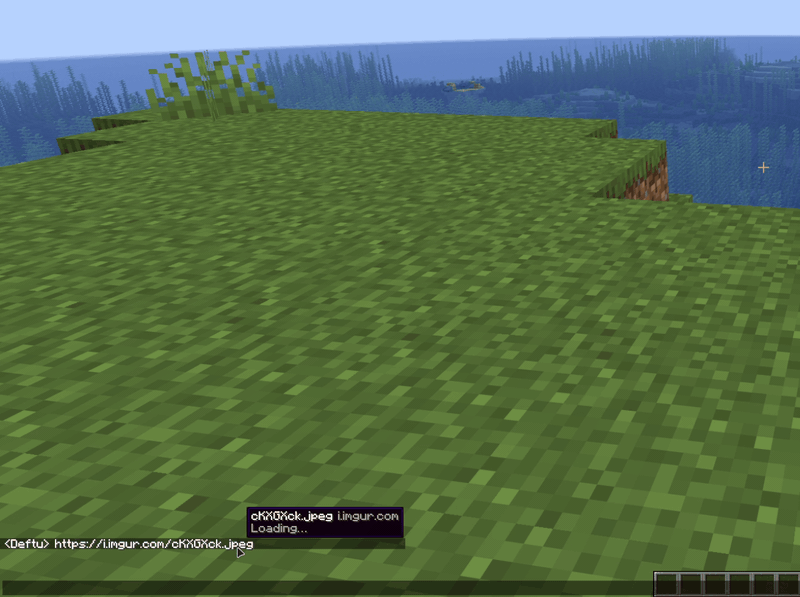
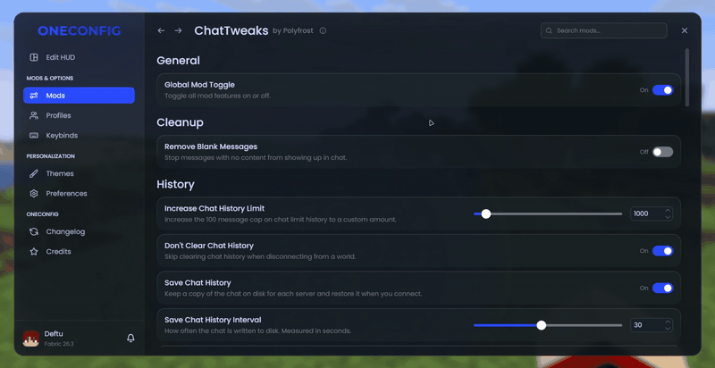

# ChatTweaks

ChatTweaks is a bundle of small improvements for the Minecraft chat.

### Compact chat

Repeated messages stack into one line with a counter like `(2)` instead of filling up your chat.

- Choose how recent a message has to be to stack (up to 2 minutes)
- 10 counter formats and a custom counter color
- Only stack a message when it repeats the one right above it

### Chat history

- Keep up to 16384 messages instead of the vanilla 100
- Chat no longer clears when you leave a world or server
- History is saved per account and per server, and comes back when you rejoin
- A divider with the date and time marks each new session

### Image preview

Hover over a link in chat to see the image next to your cursor. This works for web pages that have a preview image and for your own screenshots too. Hold Shift to see it at full size.

### Timestamps

- Show the time in front of each message, or only when you hover over it
- 12 or 24 hour clock with optional seconds
- Custom brackets and color
- Only show the time when it changes

### Smaller tweaks

- Type commands longer than the vanilla chat box allows
- See what a clickable message will run or open before you click it
- Hold Shift while pressing Enter to keep the chat open
- Fuzzy command autocomplete (not on 1.8.9)
- Hide empty chat messages

## Compatibility

ChatTweaks does not work together with Chat Patches.

## Supported versions

- Minecraft 1.8.9 on Ornithe.
- Minecraft 1.21.1-26.3 on Fabric.

ChatTweaks needs [OneConfig](https://modrinth.com/mod/oneconfig). The Fabric builds also need Fabric API.

## Support

- Report bugs and ask questions on the [Polyfrost Discord](https://polyfrost.org/discord).
- Check [Polyfrost Status](https://status.polyfrost.org/) if a Polyfrost service is down.

## License

ChatTweaks is adapted from [PolyPatcher](https://modrinth.com/mod/patcher) by Polyfrost. Both use the CC BY-NC-SA 4.0 license.
